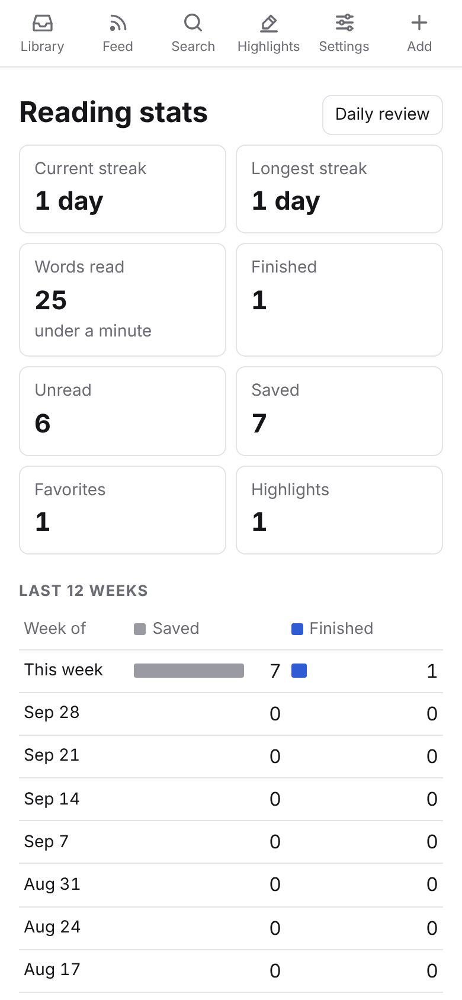
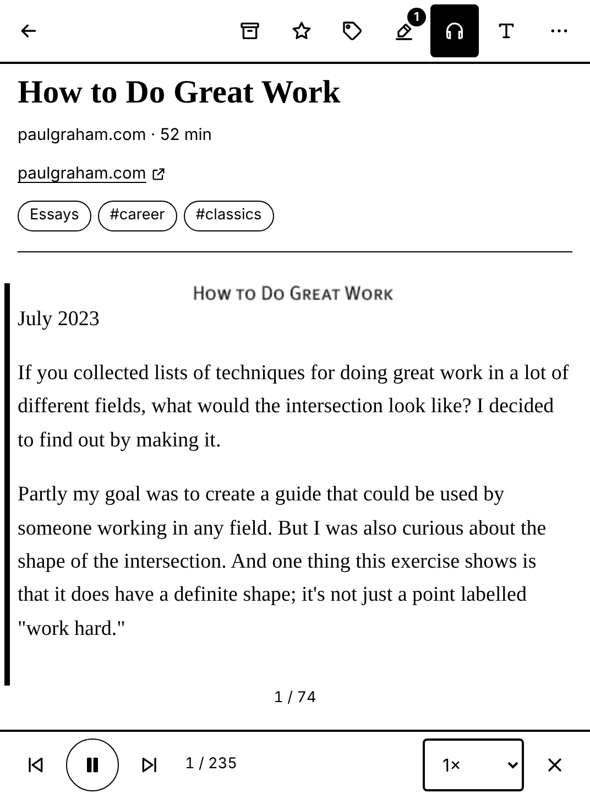

# Readlater

A minimal read-it-later app in the spirit of Readwise Reader. Save articles, X posts, papers, PDFs, EPUBs,
YouTube videos and newsletters from anywhere (browser extension, bookmarklets, the share sheet, a Telegram bot,
email, an HTTP API), follow RSS feeds, and read everything in one clean reader with highlights, tags,
read-aloud and full-text search. It runs as a web app (PWA) and as an Android and iOS app, and it is made to
work well on black-and-white e-ink readers such as the Boox Go 6.

You host it yourself on Firebase (Hosting, Auth, Firestore, Cloud Functions, Storage). A personal library fits
in the free quotas of the pay-as-you-go plan. AI summaries, the Telegram bot and email newsletters are optional
and off until you configure them.

<p>
  
  
  
</p>
<p>
  
  
  
  
</p>

The end-to-end tests take these screenshots (`npm --prefix e2e run screenshots`). The reader screenshots are
1072×1448 px, the Boox Go 6 screen.

## Features

**Save**

- **Anything with a URL.** Web articles (Readability-based extraction with metadata), X/Twitter posts and
  whole self-threads, arXiv and DOI papers, PDFs (text extraction, and the original pages through pdf.js),
  EPUBs (chapters and table of contents), and YouTube videos with their **transcript** (timestamped
  paragraphs that link into the video) or Vimeo pages.
- **Pages as you see them.** The browser extension sends the rendered page, so articles behind a login or a
  paywall you have access to are saved as you see them. Dead or paywalled pages fall back to the latest
  **Internet Archive** snapshot, with a note at the top.
- **From everywhere**: browser extension, bookmarklets, Android share sheet, iOS Shortcut, Telegram bot, a
  personal email address for newsletters, and an HTTP API (see [Saving from anywhere](#saving-from-anywhere)).
- **RSS feeds and newsletters.** Follow a site by its address (the feed is discovered automatically).
  New posts and newsletter issues land in the Feed, and you save the ones you want to the Library. OPML import
  and export, per-feed category and tags, optional full-text fetching, and an hourly refresh.

**Read**

- **Reader.** Scroll or paginated mode: tap the left or right side to turn pages, use the arrow keys, or the
  volume keys in the Android app. Font, size, line height, width and justification, with **Literata** and
  **Atkinson Hyperlegible** bundled. Reading progress syncs across devices.
- **Listen.** Read-aloud with play/pause, previous/next paragraph, speed and voice; it follows along in the
  text (and turns the pages in pages mode). Uses the browser's voices on the web and the system's text-to-speech
  in the apps.
- **Finish and move on.** "Next unread" at the end of every article, and optional auto-archive when you reach
  the end.
- **Themes.** System, light, dark, sepia and **e-ink**: pure black on white, no animations or shadows, larger
  tap targets, and paginated reading by default.

**Organise**

- Unread, Archive and Favorites; categories; tags; filters by type, category and tag; sorting.
- **Saved views**: keep any filter combination as a tab on the Library.
- **Auto rules**: "when the domain / URL / title / feed / type / source matches …, add tags, set a category,
  favorite, archive or move to the Feed", applied on the server to everything you save.
- **Bulk actions**: select items to archive, favorite, tag, categorise, move, export or delete them together.
- **Search.** Titles, authors, tags and notes instantly on the device, and the full text through a
  server-side index. Keyboard shortcuts (`j`/`k`, `o`, `e` archive, `s` favorite, `/` search, `a` add).

**Highlights and knowledge**

- Select text and choose Highlight, in four colours (shown as different underlines on e-ink), optionally
  with a note. Each document can have its own note.
- All highlights on the Highlights page, exported as Markdown; per document **Copy as Markdown** with front
  matter for Obsidian and similar tools.
- **Daily review**: five highlights a day to revisit.

**AI (optional)**

- **Summary** (a TL;DR line and the key points, cached on the document) and **Ask** (answers grounded in
  the document, quoting it) in the reader, using Anthropic's Claude with your own API key. See
  [Optional integrations](#optional-integrations).

**Share and export**

- **Public links**: a read-only copy of a document (optionally with your highlights) at `/s/…` that anyone
  can open without signing in; turn the link off at any time.
- **EPUB export** of one document or a whole selection, made for e-readers.
- Import URL lists, Pocket and Instapaper CSV, OPML; JSON export of everything.

**Everywhere**

- **Reading stats**: saved and finished per week, words read, reading streak, top tags and sites.
- **Sign in** with Google, or link another device with a one-time code or QR code, which is handy on e-readers.
- **Works offline.** The library, already-opened documents and pending changes are kept on the device.

## Saving from anywhere

| From | How |
|---|---|
| Web app | **+ Add** (paste a link, or choose a PDF/EPUB), paste a link anywhere on the page, or drop a file or link onto it. |
| Android, Boox | Share a link, PDF or EPUB to **Readlater** from any app. |
| iPhone, iPad | An iOS Shortcut in the share sheet that calls the API with your key. Settings → *Saving from anywhere* shows the exact steps for your site. |
| Browser extension | Chrome, Edge and Firefox ([extension/](extension/README.md); store zips are built by CI). One click saves the page **with its rendered HTML**, then lets you add tags, a category and a note; context menu for links; <kbd>Alt</kbd>+<kbd>Shift</kbd>+<kbd>S</kbd>; a ✓ badge on pages you already saved. Settings → *Browser extension* creates its key. |
| Bookmarklets | Settings → *Bookmarklets*. **Save to Readlater** saves the page in a small window that closes itself (works on any site; uses its own save-only API key, which cannot read your library); **Open in Readlater** opens the page in the web app, where you confirm the save. |
| Telegram | Send or forward a message with links, or a PDF/EPUB, to your bot. `#hashtags` become tags, text without a link is saved as a note, `/latest` lists your newest unread items. Connect it in Settings → *Telegram*. Optional. |
| Email | Settings → *Email newsletters* gives you a personal address. Newsletters sent to it arrive in the Feed; a mail that is just a link saves the link. Optional. |
| RSS | Feed → *Manage feeds*: follow a site or import OPML. |
| Scripts, automations | The HTTP API with an API key created in Settings (below). |
| Other apps | Settings → *Import*: URL lists, Pocket and Instapaper CSV, OPML. |

### HTTP API

Every request is authorised with an API key (`Authorization: Bearer rl_…`, or `?key=`). CORS is open to all
origins, because requests are authorised by the key and not by cookies. Keys are shown once when you create
them and can be revoked in Settings.

| Request | Result |
|---|---|
| `POST /api/save` JSON `{url, title?, tags?, category?, categoryId?, note?, location?, html?}` (or a form, or plain text with a URL) | `{ok, id, existing}`. `category` is a category id or name (a new name creates it), `categoryId` an id, `null` clears. `location` is `library` (default) or `feed`. `html` (≤ 5 MB) is the rendered page: it is extracted instead of fetching the URL. Saving a URL again updates the existing item (tags are merged). |
| `GET /api/save?url=…&key=…[&title=&tags=&category=&note=]` | The same, as a plain link. A browser gets a small "Saved ✓" page that closes itself when it was opened as a popup. |
| `GET /api/lookup?url=…` | `{saved, id?, status?, location?}` |
| `GET /api/tags` | `{tags}`, most used first |
| `GET /api/categories` | `{categories: [{id, name}]}` |
| `GET /api/items?status=unread&limit=20` | `{items: [{id, title, url, createdAt}]}` (Library, newest first; `status` `unread`, `archived` or `all`; `limit` ≤ 100) |

```sh
curl -X POST https://<your-project>.web.app/api/save \
  -H "Authorization: Bearer rl_…" -H "Content-Type: application/json" \
  -d '{"url":"https://www.paulgraham.com/greatwork.html","tags":["essays"]}'
# → {"ok":true,"id":"…","existing":false}
```

## Optional integrations

AI, the Telegram bot and email newsletters are switched off until you configure them, and the app hides them
while they are off. `scripts/setup.sh` asks for each one (re-run it any time to add, change or switch one off;
press Enter to skip). It keeps the settings in `functions/.env.<project>` (git-ignored) and the secrets in Google
Cloud Secret Manager; a secret is attached to the functions only while its feature is switched on, so a project
without any of them deploys normally.

| Integration | You need | What `setup.sh` stores |
|---|---|---|
| **AI** (Summary and Ask in the reader) | An [Anthropic API key](https://console.anthropic.com/settings/keys). Usage is billed to you by Anthropic; each user can make 100 AI requests a day, and a cached summary costs nothing. The text of the document you summarise or ask about is sent to the Anthropic API. | secret `ANTHROPIC_API_KEY`, `AI_ENABLED=1` |
| **Telegram bot** | A bot from [@BotFather](https://t.me/BotFather) (`/newbot`, then paste its token). | secrets `TELEGRAM_BOT_TOKEN` and a random `TELEGRAM_WEBHOOK_SECRET`, `TELEGRAM_BOT_USERNAME` |
| **Email newsletters** | A domain or subdomain whose mail you can route to a webhook: Cloudflare Email Routing (free, with the worker in [integrations/cloudflare-email-worker](integrations/cloudflare-email-worker/README.md)), Mailgun routes or SendGrid Inbound Parse. | `INBOUND_EMAIL_DOMAIN`, a random secret `INBOUND_EMAIL_SECRET` |

After a functions deploy, `scripts/deploy.sh` registers the Telegram webhook
(`https://us-central1-<project>.cloudfunctions.net/telegram`) with its secret and sets the bot's command list.
For email, point your mail provider at `https://us-central1-<project>.cloudfunctions.net/inboundEmail` with
the secret in the `X-Readlater-Secret` header or as `?secret=` (`firebase functions:secrets:access
INBOUND_EMAIL_SECRET` prints it). Other settings you can add to `functions/.env.<project>`: `ANTHROPIC_MODEL`
(default `claude-opus-5-5`) and `PUBLIC_URL` (your app's address when it is not `https://<project>.web.app`).

Without the script: set the secrets with `firebase functions:secrets:set NAME`, write the plain values to
`functions/.env.<project>`, and deploy. For deploys from GitHub Actions, put the non-secret lines of that file
into the repository variable `FUNCTIONS_ENV` (the script offers to do it).

## Architecture

```
  Browser / PWA          Android & Boox app        iOS app        Extension, bookmarklets,    Telegram,
  (web/, React)          (Capacitor, share          (Capacitor)    Shortcuts, scripts          mail providers
        │                 intents, volume keys)          │                │                         │
        └───────────────┬──────────┴────────────────────┘                │ HTTPS + API key         │ webhooks
                        │  Firebase JS SDK (offline cache)               │                         │ + secret
                        ▼                                                ▼                         ▼
 ┌──────────────────────────────────────────────────────────────────────────────────────────────────────┐
 │ Firebase                                                                                             │
 │  Hosting ── serves web/dist (incl. public /s/{token} pages), rewrites /api/** ──► api (HTTP)         │
 │  Auth ───── Google sign-in, custom tokens from one-time codes                                        │
 │  Firestore  users/{uid}/items, content chunks, highlights, categories, feeds, views, rules, search,  │
 │             apiKeys, integrations; top-level shares (public read) — rules allow each user only       │
 │             their own data                                                                           │
 │  Storage ── uploaded PDFs/EPUBs, captured pages, downloaded PDFs, EPUB images, EPUB exports          │
 │  Functions (Node 22, us-central1)                                                                    │
 │    processItem   on item write: fetch (or read the captured page) + extract, sanitise, store         │
 │                  content and metadata, apply auto rules, build the search index                      │
 │    cleanupItem / cleanupShare   on item delete: content, index, highlights, files, public link       │
 │    pollFeeds     hourly: RSS/Atom/JSON feeds into the Feed                                           │
 │    api           save, lookup, tags, categories, items                                               │
 │    telegram, inboundEmail   bot webhook and newsletter webhook (optional)                            │
 │    callables     createLoginCode, redeemLoginCode, createApiKey, revokeApiKey, search, saveUrl,      │
 │                  addFeed, refreshFeeds, importOpml, getConfig, createTelegramLink, unlinkTelegram,   │
 │                  getInboundEmail, ai, createShare, revokeShare, exportEpub                           │
 └──────────────────────────────────────────────────────────────────────────────────────────────────────┘
                                                        │ ai (optional)
                                                        ▼
                                              Anthropic Messages API
```

The client writes an item with `fetchStatus: 'pending'`. `processItem` extracts it and writes the content,
and the client sees the result through its live listener. The data model, function contracts and UI
conventions are in [docs/SPEC.md](docs/SPEC.md) and, for everything added in the second wave (integrations,
rules, views, AI, sharing, export), [docs/SPEC-2.md](docs/SPEC-2.md).

## Quick start (local, on the emulators)

Requirements: Node.js 22, Java 21 (for the Firestore emulator), and internet access (the functions fetch the
pages you save).

```sh
npm ci && npm --prefix functions ci && npm --prefix web ci && npm --prefix e2e ci

npm --prefix functions run build      # or `npm --prefix functions run watch` while you edit functions
npm --prefix web run build:emu        # web/dist for the Hosting emulator
npm run emulators                     # firebase emulators:start --project demo-readlater
```

Open <http://127.0.0.1:5000> and choose **Continue with Google**. The Auth emulator shows a fake account
picker where **Add new account** creates a test user. For hot reload, run `npm --prefix web run dev:emu`
(Vite on <http://localhost:5173>, connected to the same emulators).

Emulator ports: Hosting 5000, Functions 5001, Firestore 8080, Auth 9099, Storage 9199. The project id
`demo-readlater` never touches a real Firebase project.

## Deploy

**One-time setup** of a Google Cloud / Firebase project, then the first deploy:

```sh
scripts/setup.sh --project my-readlater
```

The script is interactive and safe to re-run. It needs `gcloud` and Node.js. It creates or selects the
project, links billing (Cloud Functions need the Blaze plan), enables the APIs, creates Firestore and Storage,
grants the service account permissions, walks you through enabling Google sign-in (a console step), writes
the web config to `web/.env.production`, offers the [optional integrations](#optional-integrations), and
deploys. At the end it can create a deploy service account for GitHub Actions.
Non-interactive runs (`--yes`, or no terminal) take the defaults and skip the integrations unless
`READLATER_ANTHROPIC_API_KEY`, `READLATER_TELEGRAM_BOT_TOKEN` or `READLATER_INBOUND_EMAIL_DOMAIN` are set.

**Later deploys:** `scripts/deploy.sh --project my-readlater` (rules, indexes, functions and hosting;
`--only hosting` and similar to limit the targets). After a functions deploy it re-registers the Telegram
webhook when the bot is set up.

**GitHub Actions:** `.github/workflows/deploy.yml` deploys every push to `main` once these are set in the
repository settings:

| Name | Kind | Value |
|---|---|---|
| `FIREBASE_SERVICE_ACCOUNT` | secret | JSON key of a deploy service account (`scripts/setup.sh` can create it and set both entries with `gh`) |
| `FIREBASE_PROJECT_ID` | variable | your project id; defaults to the key's project |
| `VITE_PUBLIC_URL` | variable, optional | public URL if not `https://<project>.web.app` |
| `FUNCTIONS_ENV` | variable, optional | the non-secret lines of `functions/.env.<project>` (e.g. `AI_ENABLED=1`, `TELEGRAM_BOT_USERNAME=…`, `INBOUND_EMAIL_DOMAIN=…`), so deploys keep the optional integrations on; `scripts/setup.sh` can set it. The secrets stay in Secret Manager. |
| `ANDROID_KEYSTORE_BASE64`, `ANDROID_KEYSTORE_PASSWORD`, `ANDROID_KEY_ALIAS`, `ANDROID_KEY_PASSWORD` | secrets, optional | release-sign the APK that is attached to a GitHub Release after each deploy; without them no APK is published (a debug build is signed with the key in this repository, so anyone could sign an "update" for it) |

`ci.yml` runs on every push: typechecks and unit tests, the browser extension checks and store zips (uploaded
as an artifact), functions tests, security-rules and end-to-end tests on the emulators, a debug APK (uploaded
as an artifact) and an iOS simulator build.

## Android and Boox

Install the APK from the GitHub Release that each deploy creates (when a release keystore is set up), or build it with
`scripts/build-android.sh`. On a Boox, choose *Settings → Appearance → E-ink* in Readlater and a sharp refresh
mode (*Regal* or *HD*) for the app in the Boox E-Ink Center. Turn pages by tapping the sides of the page or with
the volume keys. The full guide, covering sideloading, Boox settings, sharing and signing in, is in
[docs/NATIVE.md](docs/NATIVE.md).

## iOS

Build and run from Xcode: `cd web && npm run build && npx cap sync ios && npx cap open ios`, then choose your
team under *Signing & Capabilities*. Save from Safari and other apps with the iOS Shortcut described in
Settings. Details are in [docs/NATIVE.md](docs/NATIVE.md#ios).

## Project layout

```
web/                 React 19 + Vite SPA, also the Capacitor app
  src/lib/           Firebase init, data access + hooks, types, per-device prefs
  src/pages/         Library, Feed, Feeds, Search, Highlights, Review, Stats, Settings, public share page, …
  src/reader/        reader: article view, pagination, highlights, PDF viewer, read-aloud, AI, sharing
  src/components/    item rows and lists, dialogs, tag input, category select, menus, toasts
  src/native.ts      Capacitor bridge (share intents, deep links, volume keys)
  android/ ios/      native projects
functions/           Cloud Functions (TypeScript)
  src/extract/       URL/file/captured page → readable HTML (article, tweet + thread, arXiv/DOI, PDF, EPUB,
                     YouTube transcript, Internet Archive fallback)
  src/feeds/         feed discovery, parsing, polling, OPML
  src/api.ts …       HTTP API, auth codes, API keys, search, processing, auto rules
  src/telegram.ts …  Telegram bot, inbound email, integrations config, AI, shares, EPUB export
  test/              Vitest unit tests with fixtures
e2e/                 Playwright end-to-end tests and security-rules tests (emulators)
extension/           browser extension (Manifest V3)
integrations/        Cloudflare Email Worker for newsletters
scripts/             setup.sh, deploy.sh, build-android.sh, icon generation
docs/                SPEC.md + SPEC-2.md (contracts), NATIVE.md (apps), screenshots/
firebase.json  firestore.rules  firestore.indexes.json  storage.rules
```

## Testing

```sh
npm --prefix functions test           # unit tests: extraction, feeds, search index, API, Telegram, email, rules, AI, …
npm --prefix web test                 # unit tests: components, reader, highlights, read-aloud, settings, importers
npm --prefix web run typecheck
npm run test:emulators                # functions tests that need the Firestore and Storage emulators
                                      # (functions/test/ingest.emulator.test.ts needs its own run: see its header)
npm --prefix e2e run test:rules       # Firestore and Storage security rules on the emulators
npm --prefix e2e run test:e2e         # Playwright, see below
npm --prefix e2e test                 # rules + end-to-end
extension/build.sh                    # checks the extension and builds its store zips
```

`test:e2e` builds the functions and the emulator build of the web app, starts the emulators (or reuses
running ones), and drives the real UI in Chromium on a 360 px phone screen with one Google account from the
Auth emulator:

1. Google sign-in through the emulator's account picker shows the empty library.
2. Adding an article shows it while it is processing and then with its real title. The reader shows the text,
   turns a page in pages mode, and keeps the page after a reload.
3. A highlight with a note shows up on /highlights, and the Markdown export contains it.
4. An API key created in Settings saves a link through `POST /api/save`.
5. Categories and tags are created, assigned and used as filters (Filters dialog, removable filter chips).
6. Archive, favorite and unarchive work from the list and from the reader.
7. A one-time code from Settings → *Link a device* signs in a second browser.
8. Following an RSS feed fills the Feed, and an entry can be saved to the Library.
9. A generated PDF and EPUB are uploaded and processed. The PDF's original pages render, and the EPUB has a
   table of contents.
10. Full-text search finds words that appear only in a document's body.
11. The e-ink, dark and light themes switch from Settings.
12. At 360×640, the library and reader have no horizontal scrolling, in both the e-ink and light themes.
13. A highlight's colour changes in its dialog, and the reader and /highlights show the new colour.
14. Read-aloud opens its player, marks the paragraph being read, pauses, skips and closes (with a scripted
    stand-in for the browser's speech engine, because headless Chromium has no voices).
15. The sepia theme is chosen in the reader's text settings and shows up in Settings.
16. Bulk select archives two items at once, and moves one back from the Archive.
17. A filter is saved as a view and reopened from its chip.
18. An auto rule created in Settings tags and favorites a link saved through `/add` (which asks before saving).
19. A plain `GET /api/save` with the bookmarklet's key saves a link, and the same key cannot read the library.
20. Reading stats and the daily review show the library and the highlight; the review opens the document at it.
21. *Download as EPUB* in the reader downloads a valid EPUB with the article.
22. The README screenshots are taken.

A second account then walks through the integrations (`e2e/specs/integrations.spec.ts`), with the real
functions and local stand-ins for the Telegram Bot API and the Anthropic API:

23. `getConfig` reports the integrations without sign-in, and Settings offers them.
24. The browser extension's requests: a save with the rendered page is extracted without fetching it, the
    popup's follow-up sets tags, category and note, and lookup, tags, categories, items, CORS and the 5 MB
    limit behave as the extension expects. The reader shows the captured text.
25. An auto rule tags and favorites a matching page when it is processed.
26. The *Save to Readlater* bookmarklet from Settings saves the page it runs on, and its popup closes itself;
    its save-only key is refused by the read endpoints.
27. Telegram: a chat is linked, a link is saved and the reply is edited with the page title, a note is
    saved, and `/latest` answers.
28. Newsletters arrive in the Feed as JSON, Mailgun, SendGrid and raw MIME posts; duplicates are dropped; a
    mailed link is saved to the Library.
29. Summarize in the reader shows the summary, which is then cached; Ask sends the document and the question.
30. A public share link created in the reader opens in a signed-out browser with the highlights, and stops
    working once it is turned off.
31. An EPUB export downloads and is read back by the app's own EPUB extractor.

Useful knobs: `E2E_SKIP_BUILD=1` (reuse the current builds), `E2E_EMULATOR_LOGS=1` (print the emulator
output), `PLAYWRIGHT_CHROMIUM_PATH` (use a Chromium that is already installed). The tests save real pages
(paulgraham.com, example.com, hnrss.org), so they need internet access. The global setup writes a temporary
`functions/.env.local` with the integration test settings (`e2e/helpers/integrations.ts`) and removes it
afterwards; behind an HTTP proxy it also passes `HTTPS_PROXY` to the functions there and keeps it away from the
Firebase CLI. Emulators you started yourself are reused as they are, and the integration tests skip themselves
when those emulators run without the test settings.
