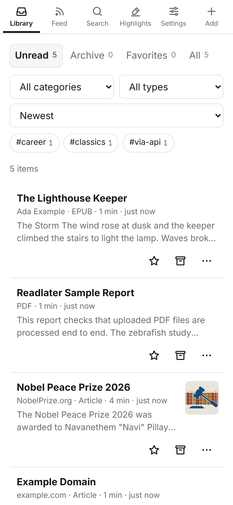
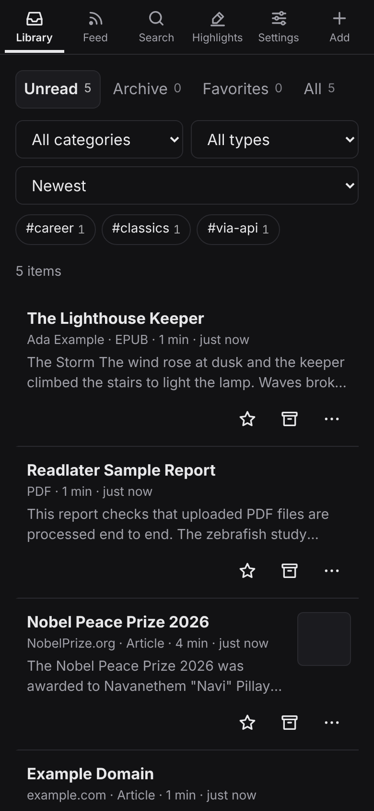
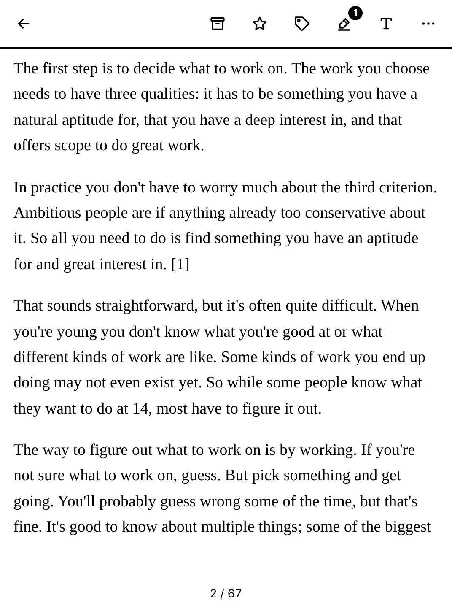
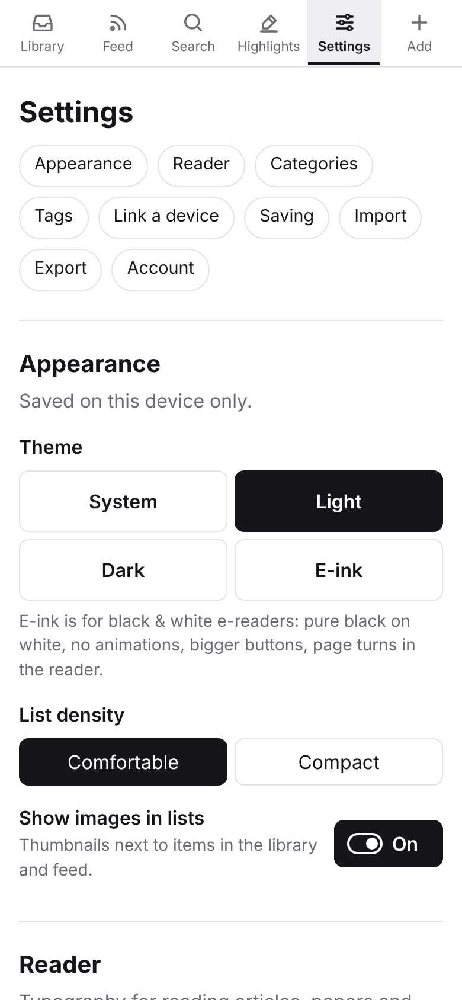
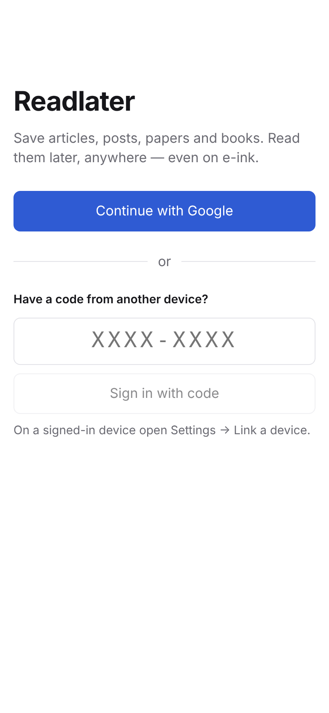

# Readlater

A minimal read-it-later app in the spirit of Readwise Reader. Save articles, X posts, papers, PDFs and EPUBs,
follow RSS feeds, and read everything in one clean reader with highlights, tags and full-text search. It runs
as a web app (PWA) and as an Android and iOS app, and it is made to work well on black-and-white e-ink readers
such as the Boox Go 6.

You host it yourself on Firebase (Hosting, Auth, Firestore, Cloud Functions, Storage). A personal library fits
in the free quotas of the pay-as-you-go plan.

<p>
  
  
  
</p>
<p>
  
  
</p>

The end-to-end tests take these screenshots (`npm --prefix e2e run screenshots`). The reader screenshot is
1072×1448 px, the Boox Go 6 screen.

## Features

- **Save anything.** Web articles (Readability-based extraction with metadata), X/Twitter posts,
  arXiv and DOI papers, PDFs (text extraction, and the original pages through pdf.js), EPUBs (chapters and
  table of contents), and YouTube and Vimeo pages.
- **RSS feeds.** Follow a site by its address (the feed is discovered automatically). New posts land in the
  Feed, and you save the ones you want to the Library. OPML import and export, per-feed category and tags,
  optional full-text fetching, and an hourly refresh.
- **Reader.** Scroll or paginated mode: tap the left or right side to turn pages, use the arrow keys, or the
  volume keys in the Android app. Typography settings for font, size, line height, width and justification.
  Reading progress syncs across devices.
- **Highlights and notes.** Select text and choose Highlight, optionally with a note. Highlights are listed per
  document and on the Highlights page, and can be exported as Markdown. Each document can have its own note.
- **Organise.** Unread, Archive and Favorites views; categories; tags; filters by type, category and tag;
  sorting; keyboard shortcuts (`j`/`k`, `o`, `e` archive, `s` favorite, `/` search, `a` add).
- **Search.** Titles, authors, tags and notes are searched instantly on the device, and the full text through
  a server-side index.
- **Themes.** System, light, dark and **e-ink**: pure black on white, no animations or shadows, larger tap
  targets, and paginated reading by default.
- **Sign in** with Google, or link another device with a one-time code or QR code, which is handy on e-readers.
- **Import and export.** URL lists, Pocket and Instapaper CSV, OPML; JSON export of everything.
- **Works offline.** The library, already-opened documents and pending changes are kept on the device.

## Saving from anywhere

| From | How |
|---|---|
| Web app | **+ Add** (paste a link, or choose a PDF/EPUB), paste a link anywhere on the page, or drop a file or link onto it. |
| Android, Boox | Share a link, PDF or EPUB to **Readlater** from any app. |
| iPhone, iPad | An iOS Shortcut in the share sheet that calls the API with your key. Settings → *Saving from anywhere* shows the exact steps for your site. |
| Desktop browser | The **bookmarklet** in Settings → *Saving from anywhere*, which opens `/add?url=…` using your web session. |
| Scripts, automations | `POST /api/save` with an API key created in Settings (see below). |
| Browser extension | `extension/` (Chrome, Edge, Firefox), see [extension/README.md](extension/README.md). Its already-saved badge and its tag and category suggestions use the `/api/lookup`, `/api/tags` and `/api/categories` endpoints planned in [docs/SPEC-2.md](docs/SPEC-2.md). |

The HTTP API:

```sh
# JSON body: url (required), title, tags, category (a name; it is created if missing)
curl -X POST https://<your-project>.web.app/api/save \
  -H "Authorization: Bearer rl_…" -H "Content-Type: application/json" \
  -d '{"url":"https://www.paulgraham.com/greatwork.html","tags":["essays"]}'
# → {"ok":true,"id":"…"}

# Also works as a plain link, e.g. from a shortcut or another app (shows a small "Saved" page in a browser):
https://<your-project>.web.app/api/save?key=rl_…&url=https%3A%2F%2Fexample.com
```

Keys are shown once when you create them and can be revoked in Settings. CORS is open to all origins, because
requests are authorised by the key and not by cookies.

## Architecture

```
  Browser / PWA          Android & Boox app        iOS app            Shortcuts, scripts,
  (web/, React)          (Capacitor, share          (Capacitor)        bookmarklet, extension
        │                 intents, volume keys)          │                     │
        └───────────────┬──────────┴────────────────────┘                     │
                        │  Firebase JS SDK (offline cache)                    │ HTTPS + API key
                        ▼                                                     ▼
 ┌──────────────────────────────────────────────────────────────────────────────────────────┐
 │ Firebase                                                                                 │
 │  Hosting ── serves web/dist, rewrites /api/** ──────────────────────────► api (HTTP)     │
 │  Auth ───── Google sign-in, custom tokens from one-time codes                            │
 │  Firestore  users/{uid}/items, content chunks, highlights, categories, feeds, search,    │
 │             apiKeys — security rules allow each user only their own data                 │
 │  Storage ── uploaded PDFs/EPUBs, downloaded PDFs, EPUB images                            │
 │  Functions (Node 22, us-central1)                                                        │
 │    processItem   on item write: fetch + extract (article/tweet/paper/pdf/epub/video),    │
 │                  sanitise, store content chunks and metadata, build the search index     │
 │    cleanupItem   on item delete: content, search index, highlights, files                │
 │    pollFeeds     hourly: fetch RSS/Atom/JSON feeds, add new entries to the Feed          │
 │    callables     createLoginCode, redeemLoginCode, createApiKey, revokeApiKey, search,   │
 │                  saveUrl, addFeed, refreshFeeds, importOpml                              │
 └──────────────────────────────────────────────────────────────────────────────────────────┘
```

The client writes an item with `fetchStatus: 'pending'`. `processItem` extracts it and writes the content,
and the client sees the result through its live listener. The data model, function contracts and UI
conventions are in [docs/SPEC.md](docs/SPEC.md).

## Quick start (local, on the emulators)

Requirements: Node.js 22, Java 21 (for the Firestore emulator), and internet access (the functions fetch the
pages you save).

```sh
npm ci && npm --prefix functions ci && npm --prefix web ci && npm --prefix e2e ci

npm --prefix functions run build      # or `npm --prefix functions run watch` while you edit functions
npm --prefix web run build:emu        # web/dist for the Hosting emulator
npm run emulators                     # firebase emulators:start --project demo-readlater
```

Open <http://127.0.0.1:5000> and choose **Continue with Google**. The Auth emulator shows a fake account
picker where **Add new account** creates a test user. For hot reload, run `npm --prefix web run dev:emu`
(Vite on <http://localhost:5173>, connected to the same emulators).

Emulator ports: Hosting 5000, Functions 5001, Firestore 8080, Auth 9099, Storage 9199. The project id
`demo-readlater` never touches a real Firebase project.

## Deploy

**One-time setup** of a Google Cloud / Firebase project, then the first deploy:

```sh
scripts/setup.sh --project my-readlater
```

The script is interactive and safe to re-run. It needs `gcloud` and Node.js. It creates or selects the
project, links billing (Cloud Functions need the Blaze plan), enables the APIs, creates Firestore and Storage,
grants the service account permissions, walks you through enabling Google sign-in (a console step), writes
the web config to `web/.env.production`, and deploys. At the end it can create a deploy service account for
GitHub Actions.

**Later deploys:** `scripts/deploy.sh --project my-readlater` (rules, indexes, functions and hosting;
`--only hosting` and similar to limit the targets).

**GitHub Actions:** `.github/workflows/deploy.yml` deploys every push to `main` once these are set in the
repository settings:

| Name | Kind | Value |
|---|---|---|
| `FIREBASE_SERVICE_ACCOUNT` | secret | JSON key of a deploy service account (`scripts/setup.sh` can create it and set both entries with `gh`) |
| `FIREBASE_PROJECT_ID` | variable | your project id; defaults to the key's project |
| `VITE_PUBLIC_URL` | variable, optional | public URL if not `https://<project>.web.app` |
| `ANDROID_KEYSTORE_BASE64`, `ANDROID_KEYSTORE_PASSWORD`, `ANDROID_KEY_ALIAS`, `ANDROID_KEY_PASSWORD` | secrets, optional | release-sign the APK that is attached to a GitHub Release after each deploy |

`ci.yml` runs on every push: typechecks and unit tests, security-rules and end-to-end tests on the emulators,
a debug APK (uploaded as an artifact) and an iOS simulator build.

## Android and Boox

Install the APK from the GitHub Release that each deploy creates, or build it with
`scripts/build-android.sh`. On a Boox, choose *Settings → Appearance → E-ink* in Readlater and a sharp refresh
mode (*Regal* or *HD*) for the app in the Boox E-Ink Center. Turn pages by tapping the sides of the page or with
the volume keys. The full guide, covering sideloading, Boox settings, sharing and signing in, is in
[docs/NATIVE.md](docs/NATIVE.md).

## iOS

Build and run from Xcode: `cd web && npm run build && npx cap sync ios && npx cap open ios`, then choose your
team under *Signing & Capabilities*. Save from Safari and other apps with the iOS Shortcut described in
Settings. Details are in [docs/NATIVE.md](docs/NATIVE.md#ios).

## Project layout

```
web/                 React 19 + Vite SPA, also the Capacitor app
  src/lib/           Firebase init, data access + hooks, types, per-device prefs
  src/pages/         Library, Feed, Feeds, Search, Highlights, Settings, Login, Link, Add, …
  src/reader/        reader: article view, pagination, highlights, PDF viewer, typography
  src/components/    item rows and lists, dialogs, tag input, category select, menus, toasts
  src/native.ts      Capacitor bridge (share intents, deep links, volume keys)
  android/ ios/      native projects
functions/           Cloud Functions (TypeScript)
  src/extract/       URL/file → readable HTML (article, tweet, arXiv/DOI, PDF, EPUB, video)
  src/feeds/         feed discovery, parsing, polling, OPML
  src/api.ts …       HTTP API, auth codes, API keys, search, processing
  test/              Vitest unit tests with fixtures
e2e/                 Playwright end-to-end tests and security-rules tests (emulators)
extension/           browser extension (Manifest V3)
scripts/             setup.sh, deploy.sh, build-android.sh, icon generation
docs/                SPEC.md (contracts), SPEC-2.md (next wave), NATIVE.md (apps), screenshots/
firebase.json  firestore.rules  firestore.indexes.json  storage.rules
```

## Testing

```sh
npm --prefix functions test           # unit tests: extraction, feeds, search index, API, auth codes
npm --prefix web test                 # unit tests: components, reader pagination/highlights, importers
npm --prefix web run typecheck
npm --prefix e2e run test:rules       # Firestore and Storage security rules on the emulators
npm --prefix e2e run test:e2e         # Playwright, see below
npm --prefix e2e test                 # rules + end-to-end
```

`test:e2e` builds the functions and the emulator build of the web app, starts the emulators (or reuses
running ones), and drives the real UI in Chromium on a 360 px phone screen with one Google account from the
Auth emulator:

1. Google sign-in through the emulator's account picker shows the empty library.
2. Adding an article shows it while it is processing and then with its real title. The reader shows the text,
   turns a page in pages mode, and keeps the page after a reload.
3. A highlight with a note shows up on /highlights, and the Markdown export contains it.
4. An API key created in Settings saves a link through `POST /api/save`.
5. Categories and tags are created, assigned and used as filters.
6. Archive, favorite and unarchive work from the list and from the reader.
7. A one-time code from Settings → *Link a device* signs in a second browser.
8. Following an RSS feed fills the Feed, and an entry can be saved to the Library.
9. A generated PDF and EPUB are uploaded and processed. The PDF's original pages render, and the EPUB has a
   table of contents.
10. Full-text search finds words that appear only in a document's body.
11. The e-ink, dark and light themes switch from Settings.
12. At 360×640, the library and reader have no horizontal scrolling, in both the e-ink and light themes.
13. The README screenshots are taken.

Useful knobs: `E2E_SKIP_BUILD=1` (reuse the current builds), `E2E_EMULATOR_LOGS=1` (print the emulator
output), `PLAYWRIGHT_CHROMIUM_PATH` (use a Chromium that is already installed). The tests save real pages
(paulgraham.com, example.com, hnrss.org), so they need internet access. Behind an HTTP proxy, the global
setup passes `HTTPS_PROXY` to the functions through a temporary `functions/.env.local` and keeps it away from
the Firebase CLI.
